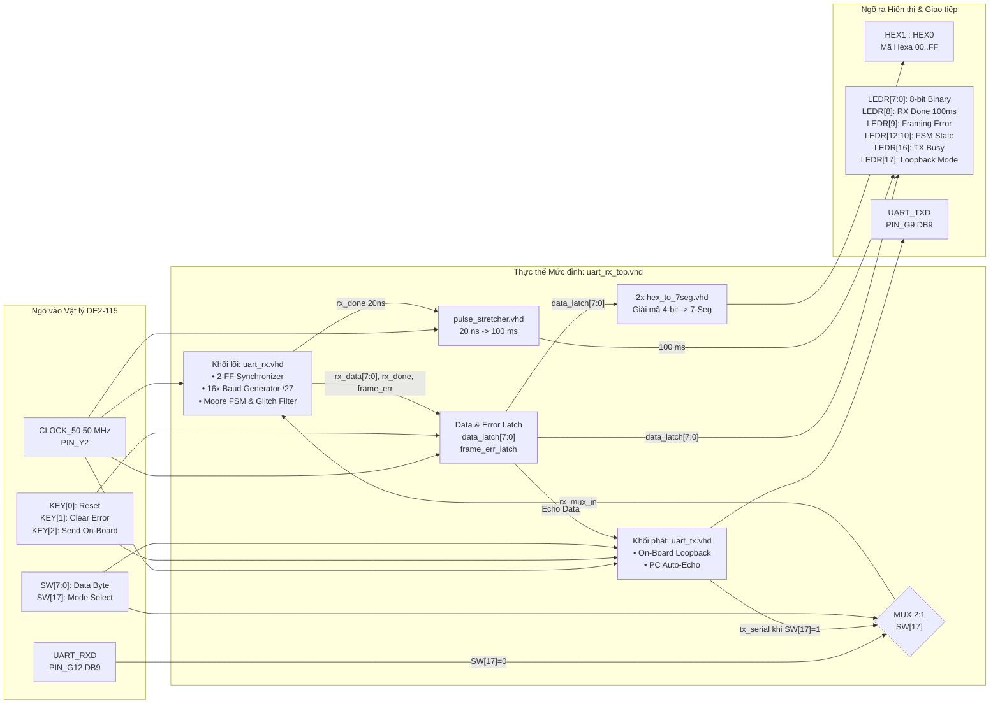
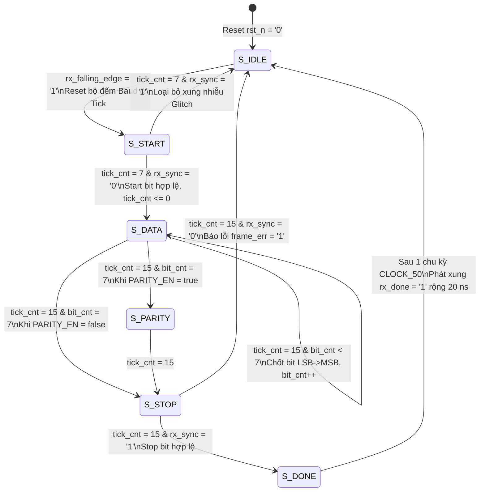

# Thiết kế Bộ Thu UART sử dụng Máy Trạng Thái Hữu Hạn trên FPGA Altera DE2-115

[](https://www.terasic.com.tw/cgi-bin/page/archive.pl?Language=English&No=502)
[]()
[]()
[]()
[]()

Dự án thiết kế phần cứng số mức RTL bằng ngôn ngữ **VHDL** cho bộ thu nối tiếp bất đồng bộ **UART Receiver** ở tốc độ **115200 bps**, khung truyền **8N1**, sử dụng kỹ thuật lấy mẫu quá mức **16x Oversampling** và **Máy trạng thái hữu hạn chuẩn Moore**, triển khai thực nghiệm trên Kit phát triển **Terasic Altera DE2-115** dùng chip FPGA Cyclone IV E `EP4CE115F29C7`.

---

## 1. Thông số kỹ thuật & Tính năng nổi bật

### Bảng thông số kỹ thuật hệ thống

| Thông số kỹ thuật | Giá trị thiết kế | Chi tiết thực thi phần cứng |
| :--- | :---: | :--- |
| **Kit phát triển mục tiêu** | **Terasic DE2-115** | Chip FPGA Altera / Intel Cyclone IV E `EP4CE115F29C7` |
| **Tần số xung nhịp `CLOCK_50`** | **50 MHz** - `PIN_Y2` | Chu kỳ xung nhịp hệ thống $T_{\text{clk}} = 20\text{ ns}$ |
| **Tốc độ truyền Baud** | **115200 bps** | Tùy biến linh hoạt qua tham số `generic` `BAUD_RATE` |
| **Cấu hình khung truyền** | **8N1** | 1 Start bit mức `0`, 8 Data bits truyền LSB trước, không Parity, 1 Stop bit mức `1` |
| **Kỹ thuật lấy mẫu** | **16x Oversampling** | Hệ số chia `BAUD_DIVISOR = 27`, tần số $f_{\text{tick}} \approx 1.8518\text{ MHz}$, sai số chỉ **$+0.47\%$** |
| **Kiến trúc điều khiển** | **Moore FSM 6 trạng thái** | `S_IDLE`, `S_START`, `S_DATA`, `S_PARITY`, `S_STOP`, `S_DONE` |
| **Đồng bộ chống Metastability** | **2-FF Synchronizer** | Chuỗi 2 tầng D Flip-Flop bảo vệ ngõ vào bất đồng bộ `UART_RXD` |
| **Bộ lọc nhiễu gai** | **Kiểm tra tâm Start bit** | Xác nhận lại mức `'0'` tại `tick_cnt = 7`, loại bỏ xung nhiễu $< 4.34\,\mu\text{s}$ |
| **Tài nguyên tiêu thụ** | **154 / 114,480 LEs, dưới 0.14%** | 97 thanh ghi chuyên dụng, 0 khối RAM, 0 khối PLL |
| **Tần số hoạt động cực đại $F_{\max}$** | **231.69 MHz** | Setup Slack $+15.684\text{ ns}$ theo mô hình Slow 1200mV 85°C |

### Điểm nhấn kỹ thuật
- **Lấy mẫu chính tâm:** Tái đồng pha bộ chia tần số ngay tại cạnh xuống của Start bit, kiểm tra Start bit ở `tick_cnt = 7` và lấy mẫu 8 bit dữ liệu cùng Stop bit tại `tick_cnt = 15` ngay giữa chu kỳ bit, tối ưu biên dự trữ nhiễu pha.
- **2 Chế độ vận hành linh hoạt qua `SW[17]`:**
  - **Chế độ On-Board Loopback khi `SW[17] = 1`:** Tích hợp sẵn bộ phát [`uart_tx.vhd`](rtl/uart_tx.vhd) nội bộ giúp kiểm thử khép kín trực tiếp bằng công tắc `SW[7:0]` và nút nhấn `KEY[2]` ngay trên kit DE2-115 mà không cần cáp RS-232 ngoài.
  - **Chế độ Giao tiếp Máy tính PC khi `SW[17] = 0`:** Nhận dữ liệu từ Laptop qua cổng RS-232 DB9 tại chân `UART_RXD` `PIN_G12` và tự động phản hồi **Echo** ngược về máy tính qua chân `UART_TXD` `PIN_G9`.
- **Hiển thị & Chẩn đoán phần cứng trực quan:**
  - Hiển thị mã Hexa của byte nhận được trên 2 LED 7 đoạn `HEX1:HEX0` và mã nhị phân 8-bit trên `LEDR[7:0]`.
  - Kéo giãn xung `rx_done` từ $20\text{ ns}$ lên **$100\text{ ms}$** trên `LEDR[8]` nhờ module [`pulse_stretcher.vhd`](rtl/pulse_stretcher.vhd).
  - Chốt cờ lỗi khung truyền trên `LEDR[9]`, xóa bằng `KEY[1]`, và xuất trạng thái FSM thời gian thực ra `LEDR[12:10]`.

---

## 2. Sơ đồ kiến trúc hệ thống

### 2.1. Sơ đồ khối mức đỉnh `uart_rx_top`



### 2.2. Lưu đồ chuyển trạng thái Máy trạng thái hữu hạn Moore `uart_rx`



---

## 3. Cấu trúc thư mục dự án

```text
UART/
├── rtl/                                             # Mã nguồn thiết kế phần cứng RTL bằng VHDL
│   ├── uart_rx.vhd                                  # Lõi bộ thu UART Receiver
│   ├── uart_tx.vhd                                  # Bộ phát UART Transmitter
│   ├── hex_to_7seg.vhd                              # Giải mã Hexa 4-bit sang LED 7 đoạn Anode chung
│   ├── pulse_stretcher.vhd                          # Mạch kéo giãn xung rx_done từ 20 ns thành 100 ms
│   └── uart_rx_top.vhd                              # Thực thể mức đỉnh tích hợp cho Kit DE2-115
├── sim/                                             # Môi trường mô phỏng kiểm chứng trên ModelSim
│   ├── tb_uart_rx.vhd                               # Self-checking Testbench kiểm thử tự động 5 kịch bản biên
│   └── run.do                                       # Tcl/DO script tự động biên dịch và cấu hình cửa sổ Waveform
├── docs/                                            # Bộ tài liệu báo cáo đồ án, nguyên lý và hướng dẫn thực hành
│   ├── BAO_CAO_DO_AN_UART_RECEIVER.docx             # Báo cáo đồ án toàn diện
│   ├── NGUYEN_LY_HOAT_DONG_VA_SO_DO_UART_RX.docx    # Tài liệu phân tích chuyên sâu nguyên lý, sơ đồ khối & Timing
│   ├── GIAI_THICH_CHI_TIET_TUNG_DONG_CODE.docx      # Giải thích chi tiết từng dòng mã VHDL của toàn bộ 5 module
│   ├── HUONG_DAN_TEST_KIT_CHI_TIET.docx             # Hướng dẫn vận hành và kiểm thử thực tế 2 chế độ trên Kit DE2-115
│   ├── HUONG_DAN_CAI_DAT_VA_SU_DUNG_HERCULES.docx   # Hướng dẫn cài đặt và dùng phần mềm Hercules kết nối Laptop ↔ FPGA
│   └── HUONG_DAN_TAI_VA_CHAY_DU_AN_TU_GITHUB.docx   # Hướng dẫn tải dự án từ GitHub và chạy 1-Click trên máy khác
├── output_files/                                    # Kết quả tổng hợp & Bitstream nạp mạch FPGA
│   ├── DE2_115_UART_RX.sof                          # File cấu hình SRAM Object File sẵn sàng nạp xuống Kit DE2-115
│   └── DE2_115_UART_RX.cdf                          # Cấu hình Chain Description File cho Quartus Programmer
├── DE2_115_UART_RX.qpf                              # File Project Intel Quartus Prime 20.1
├── DE2_115_UART_RX.qsf                              # File cấu hình dự án và gán chân vật lý DE2-115
├── DE2_115_UART_RX.sdc                              # Ràng buộc định thời chuẩn Synopsys Design Constraints 50 MHz
├── CHAY_MO_PHONG_WAVE.bat                           # Script 1-click khởi chạy mô phỏng dạng sóng trên ModelSim
├── MO_QUARTUS.bat                                   # Script mở nhanh dự án trên Intel Quartus Prime
├── NAP_KIT_FPGA.bat                                 # Script nạp tự động file .sof xuống Kit DE2-115 qua USB-Blaster
└── README.md                                        # Tài liệu tổng quan dự án
```

---

## 4. Danh mục tài liệu chi tiết trong `docs/`

Toàn bộ tài liệu học thuật, giải thích mã nguồn và hướng dẫn thực hành được chuẩn hóa trong thư mục [`docs/`](docs/):

| STT | Tài liệu | Nội dung chính | Liên kết |
| :-: | :--- | :--- | :---: |
| **1** | **Báo cáo Đồ án Thiết kế UART Receiver** | Đặt vấn đề, cơ sở lý thuyết 16x Oversampling & Metastability, thiết kế RTL, kết quả Synthesis `154 LEs`, phân tích STA $F_{\max} = 231.7\text{ MHz}$ và thực nghiệm trên DE2-115. | [`docs/BAO_CAO_DO_AN_UART_RECEIVER.docx`](docs/BAO_CAO_DO_AN_UART_RECEIVER.docx) |
| **2** | **Nguyên lý Hoạt động & Sơ đồ Khối UART RX** | Phân tích toán học sai số tốc độ Baud $+0.47\%$, sơ đồ Datapath & Control Unit, bảng chuyển trạng thái FSM Moore và giản đồ định thời. | [`docs/NGUYEN_LY_HOAT_DONG_VA_SO_DO_UART_RX.docx`](docs/NGUYEN_LY_HOAT_DONG_VA_SO_DO_UART_RX.docx) |
| **3** | **Giải thích Chi tiết Từng Dòng Code VHDL** | Giải thích cặn kẽ từng khối lệnh VHDL của cả 5 file trong `rtl/`: `uart_rx_top`, `uart_rx`, `uart_tx`, `hex_to_7seg`, `pulse_stretcher`. | [`docs/GIAI_THICH_CHI_TIET_TUNG_DONG_CODE.docx`](docs/GIAI_THICH_CHI_TIET_TUNG_DONG_CODE.docx) |
| **4** | **Hướng dẫn Kiểm thử Thực tế trên Kit DE2-115** | Bảng tra cứu nhanh nút nhấn `KEY`, công tắc `SW`, đèn `LEDR`/`HEX` và các kịch bản kiểm thử từng bước cho cả chế độ On-Board Test và chế độ PC. | [`docs/HUONG_DAN_TEST_KIT_CHI_TIET.docx`](docs/HUONG_DAN_TEST_KIT_CHI_TIET.docx) |
| **5** | **Hướng dẫn Cài đặt & Sử dụng Hercules** | Hướng dẫn kiểm tra cổng `COM`, cấu hình phần mềm Hercules ở tốc độ `115200, 8N1`, truyền ký tự ASCII/Hex và biểu diễn tính năng phát hiện lỗi khung truyền. | [`docs/HUONG_DAN_CAI_DAT_VA_SU_DUNG_HERCULES.docx`](docs/HUONG_DAN_CAI_DAT_VA_SU_DUNG_HERCULES.docx) |
| **6** | **Hướng dẫn Tải & Khởi chạy Dự án từ GitHub** | Hướng dẫn chi tiết 2 cách tải dự án qua `Download ZIP` hoặc `git clone`, lưu ý giải nén, xử lý Windows SmartScreen và khởi chạy 1-Click trên mọi máy tính. | [`docs/HUONG_DAN_TAI_VA_CHAY_DU_AN_TU_GITHUB.docx`](docs/HUONG_DAN_TAI_VA_CHAY_DU_AN_TU_GITHUB.docx) |

---

## 5. Hướng dẫn sử dụng & Khởi chạy nhanh

### Hướng dẫn tải dự án về máy tính

Dự án đã tích hợp sẵn cơ chế **tự động nhận diện đường dẫn Quartus/ModelSim đa phiên bản trên mọi ổ đĩa `C:`, `D:`, `E:`** và đính kèm sẵn file nạp [`output_files/DE2_115_UART_RX.sof`](output_files/DE2_115_UART_RX.sof). Bạn có thể tải về bất kỳ máy tính nào và chạy ngay theo **1 trong 2 cách** dưới đây, chi tiết xem thêm tại [`docs/HUONG_DAN_TAI_VA_CHAY_DU_AN_TU_GITHUB.docx`](docs/HUONG_DAN_TAI_VA_CHAY_DU_AN_TU_GITHUB.docx):

- **Cách 1 — Tải trực tiếp file nén `.ZIP` trên trình duyệt web:**
  1. Truy cập `https://github.com/hannagentai-stack/DE2-115-UART-Receiver-FSM`.
  2. Nhấn nút màu xanh lá **`<> Code`** $\rightarrow$ Chọn **`Download ZIP`**.
  3. Bấm chuột phải vào file `DE2-115-UART-Receiver-FSM-main.zip` vừa tải về $\rightarrow$ Chọn **`Extract All...`** hoặc `Extract Here` bằng WinRAR / 7-Zip.
  4. > **Lưu ý cực kỳ quan trọng:** Bắt buộc phải **Giải nén** ra thư mục thường trước khi bấm chạy các file `.bat`, không nhấp đúp chạy `.bat` trực tiếp bên trong cửa sổ xem trước của WinRAR/ZIP. Nên đặt thư mục ở đường dẫn ngắn gọn, không dấu tiếng Việt như `D:\DE2-115-UART-Receiver-FSM\`.

- **Cách 2 — Tải bằng lệnh `git clone`:**
  - Mở Terminal / PowerShell / Git Bash và chạy:
    ```bash
    git clone https://github.com/hannagentai-stack/DE2-115-UART-Receiver-FSM.git
    cd DE2-115-UART-Receiver-FSM
    ```
  - Để cập nhật phiên bản mới nhất khi đã có sẵn thư mục dự án trên máy:
    ```bash
    git pull origin main
    ```

- **Mẹo xử lý thông báo Windows SmartScreen khi mới tải file `.bat` từ Internet về:**
  - Nếu Windows hiện bảng màu xanh *"Windows protected your PC"*, nhấn vào dòng chữ **`More info`** $\rightarrow$ nhấn nút **`Run anyway`**, hoặc chuột phải vào file `.bat` / `.zip` $\rightarrow$ `Properties` $\rightarrow$ tích chọn **`Unblock`** $\rightarrow$ `OK`.

### Bước 1: Chạy mô phỏng kiểm chứng dạng sóng trên ModelSim
Nhấp đúp vào file [`CHAY_MO_PHONG_WAVE.bat`](CHAY_MO_PHONG_WAVE.bat) ở thư mục gốc. Script sẽ tự động gọi ModelSim, biên dịch toàn bộ các module trong [`rtl/`](rtl/) cùng [`sim/tb_uart_rx.vhd`](sim/tb_uart_rx.vhd) theo kịch bản [`sim/run.do`](sim/run.do) và mở cửa sổ Waveform kiểm chứng tự động **5 kịch bản biên**:
1. **Truyền các mẫu byte đặc thù:** `0x55`, `0xAA`, `0x00`, `0xFF`, `0x3C`.
2. **Truyền nối tiếp không khoảng nghỉ:** Gửi `0x12` nối tiếp ngay lập tức bởi `0x34` với thông lượng 100%.
3. **Phát hiện lỗi khung truyền:** Cố tình ép Stop bit = `'0'`, kiểm tra cờ `frame_err = '1'` và chặn xung `rx_done`.
4. **Lọc nhiễu gai Start bit:** Bơm xung nhiễu ngắn độ rộng 3 ticks tương ứng $1.62\,\mu\text{s} < 8\text{ ticks}$, FSM tự động quay về `S_IDLE`.
5. **Reset bất đồng bộ giữa khung truyền:** Kích hoạt `rst_n = '0'` khi đang nhận dữ liệu, đảm bảo FSM và thanh ghi về trạng thái khởi tạo tức thời.

### Bước 2: Mở dự án Quartus và Nạp mạch xuống Kit FPGA DE2-115
- **Mở dự án trên Quartus Prime:** Nhấp đúp vào [`MO_QUARTUS.bat`](MO_QUARTUS.bat) để mở trực tiếp project [`DE2_115_UART_RX.qpf`](DE2_115_UART_RX.qpf).
- **Nạp nhanh Bitstream `.sof`:**
  1. Cấp nguồn 12V DC cho Kit DE2-115, bật công tắc `POWER` và cắm cáp **USB-Blaster** từ cổng `BLASTER` trên Kit vào máy tính.
  2. Nhấp đúp vào [`NAP_KIT_FPGA.bat`](NAP_KIT_FPGA.bat). Script sẽ tự động nạp file [`output_files/DE2_115_UART_RX.sof`](output_files/DE2_115_UART_RX.sof) xuống FPGA.

### Bước 3: Kiểm thử thực tế trên Kit DE2-115

#### Chế độ A — Tự kiểm tra nội bộ trên mạch
1. **Gạt công tắc `SW[17]` lên mức `1`**, đèn `LEDR[17]` bật sáng báo chế độ On-Board Loopback.
2. Nhấn nút **`KEY[0]`** để Reset hệ thống, `HEX1:HEX0` hiển thị `00` và `LEDR[7:0]` tắt.
3. Đặt một mã nhị phân 8-bit bất kỳ trên 8 công tắc **`SW[7:0]`**, ví dụ `0100_0001` tương ứng `0x41` là mã ASCII của ký tự `'A'`.
4. Nhấn nút **`KEY[2]`** để phát khung UART nội bộ:
   - **`HEX1:HEX0`** lập tức hiển thị **`41`**.
   - **`LEDR[7:0]`** sáng đúng các bit tương ứng tại `LEDR[6]` và `LEDR[0]`.
   - **`LEDR[8]`** chớp sáng rõ trong **100 ms** báo nhận thành công 1 byte.

#### Chế độ B — Giao tiếp với Laptop qua cổng RS-232 và phần mềm Hercules
1. **Gạt công tắc `SW[17]` xuống mức `0`** để tắt đèn `LEDR[17]` và kết nối cáp **USB-to-RS232 DB9** từ Laptop vào cổng `RS-232` trên Kit DE2-115.
2. Mở phần mềm **Hercules SETUP utility** ở tab **Serial**, chọn đúng cổng `COMx` và thiết lập:
   - **Baud:** `115200` | **Data size:** `8` | **Parity:** `none` | **Handshake:** `OFF` -> Nhấn **`Open`**.
3. **Truyền & Nhận Echo:** Gõ phím bất kỳ trên bàn phím Laptop hoặc gửi mã Hex từ mục *Send*:
   - Mã Hexa và nhị phân hiển thị tức thời trên **`HEX1:HEX0`** và **`LEDR[7:0]`**, đèn **`LEDR[8]`** nháy sáng 100 ms, đồng thời ký tự được FPGA **Echo** ngược lại màn hình Hercules.
4. **Thử nghiệm bắt lỗi khung truyền:** Đổi tạm tốc độ Baud trên Hercules sang `9600` và gửi 1 ký tự -> Đèn **`LEDR[9]`** lập tức bật sáng chốt cờ lỗi khung truyền; nhấn nút **`KEY[1]`** trên Kit để xóa lỗi. Xem hướng dẫn chi tiết kèm hình minh họa tại [`docs/HUONG_DAN_CAI_DAT_VA_SU_DUNG_HERCULES.docx`](docs/HUONG_DAN_CAI_DAT_VA_SU_DUNG_HERCULES.docx).

---

## 6. Bảng gán chân vật lý trên Kit Altera DE2-115

| Tín hiệu cổng VHDL | Hướng | Chân FPGA `EP4CE115F29C7` | Ngoại vi trên Kit DE2-115 | Chức năng trong hệ thống |
| :--- | :---: | :---: | :--- | :--- |
| `CLOCK_50` | Input | `PIN_Y2` | Oscillator 50 MHz | Xung nhịp hệ thống toàn cục $50\text{ MHz}$ |
| `KEY[0]` | Input | `PIN_M23` | Pushbutton 0 | Master Reset bất đồng bộ tích cực mức thấp `'0'` |
| `KEY[1]` | Input | `PIN_M21` | Pushbutton 1 | Xóa cờ chốt lỗi khung truyền trên `LEDR[9]` |
| `KEY[2]` | Input | `PIN_N21` | Pushbutton 2 | Kích hoạt phát byte từ `SW[7:0]` ở chế độ On-Board Test |
| `SW[7:0]` | Input | `PIN_AB26` .. `PIN_AB28` | Slide Switches 7..0 | Cài đặt 8-bit dữ liệu cần phát với `SW[0]` là LSB |
| `SW[17]` | Input | `PIN_Y23` | Slide Switch 17 | Chọn chế độ: `'1'` là On-Board Loopback, `'0'` là PC RS-232 |
| `UART_RXD` | Input | `PIN_G12` | RS-232 DB9 MAX3232 | Đường thu dữ liệu nối tiếp từ máy tính PC |
| `UART_TXD` | Output | `PIN_G9` | RS-232 DB9 MAX3232 | Đường phát dữ liệu nối tiếp và Echo về máy tính PC |
| `LEDR[7:0]` | Output | `PIN_H19` .. `PIN_G19` | Red LEDs 7..0 | Hiển thị 8-bit nhị phân của byte vừa thu được |
| `LEDR[8]` | Output | `PIN_J17` | Red LED 8 | Chớp sáng $100\text{ ms}$ mỗi khi nhận thành công 1 byte |
| `LEDR[9]` | Output | `PIN_G17` | Red LED 9 | Báo phát hiện lỗi khung truyền |
| `LEDR[12:10]` | Output | `PIN_J16`, `PIN_H16`, `PIN_J15` | Red LEDs 12..10 | Hiển thị mã nhị phân 3-bit trạng thái FSM Moore |
| `LEDR[16]` | Output | `PIN_G16` | Red LED 16 | Báo bộ phát `uart_tx` đang bận |
| `LEDR[17]` | Output | `PIN_H15` | Red LED 17 | Báo đang bật chế độ On-Board Loopback khi `SW[17] = 1` |
| `HEX0[6:0]` | Output | `PIN_H22` .. `PIN_G18` | 7-Segment Display 0 | Hiển thị chữ số Hexa thấp `data_latch[3:0]` |
| `HEX1[6:0]` | Output | `PIN_U24` .. `PIN_M24` | 7-Segment Display 1 | Hiển thị chữ số Hexa cao `data_latch[7:4]` |
